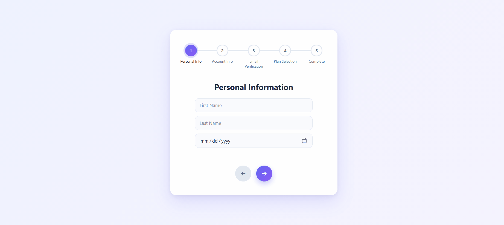
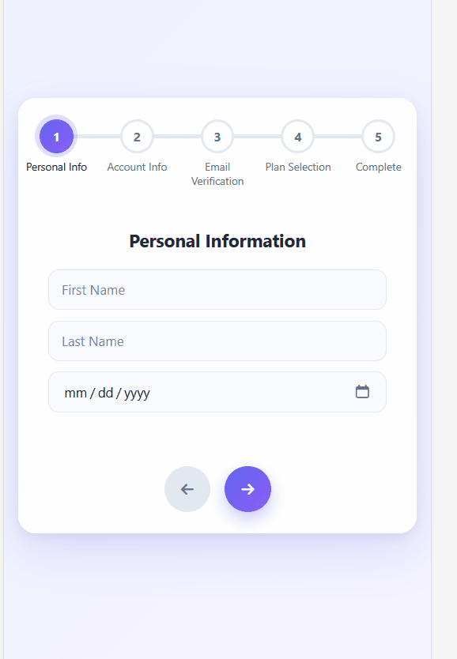

# 📊 ProgressBar

A responsive multi-step registration form with an animated progress bar, built with **HTML, CSS, and Vanilla JavaScript**.

The form has five steps. The user moves between them with the Next and Previous buttons, and the progress bar fills in step with each move.

## 🔗 Live Demo

[View Live Demo](https://anahita-valipour.github.io/ProgressBar/)

## 🎬 Preview

| Desktop | Mobile |
| :---: | :---: |
|  |  |

## ✨ Features

### Steps & Navigation

- Walk through **five steps**: Personal Info, Account Info, Email Verification, Plan Selection, and Complete.
- Keep the whole flow in **one state variable** (`currentChecked`).
- Move forward and back with the **Next** and **Previous** buttons.
- Clamp the step number so it can never go below the first step or past the last one.
- **Disable** the Previous button on the first step and the Next button on the last step.

### Progress Bar

- Mark each finished step circle with the `.checked` class.
- Calculate the bar width from the number of checked steps: `(checked - 1) / (total - 1) * 100`.
- Fill the bar smoothly with a CSS `width` transition.
- Align the bar with the centers of the first and last circles using a `.progress-track` wrapper.

### Form

- Show only **one form section at a time** by toggling the `.form-step-active` class.
- Fade and slide each new section in with a short CSS animation.
- Include text, password, date, and select inputs across the steps.

### Layout & Motion

- Scale padding, headings, and spacing with `clamp()`.
- Use `dvh` units so the layout stays stable when the mobile browser bar shows or hides.
- On small screens, show only the **current step's label** so the labels never overlap.

## 🎨 Design

- Responsive layouts for desktop and mobile.
- System font stack, with no external fonts to load.
- Soft indigo-to-violet gradient background.
- White card with rounded corners and a layered shadow.
- Gradient step circles with a soft ring around the current step.
- Round gradient navigation buttons with hover, active, and disabled states.
- **Dark mode** that follows the device setting through `prefers-color-scheme`.
- Visible focus outlines and `aria-label` on the icon-only buttons.
- Reduced-motion support for animations and transitions.

## 🛠️ Technologies

- HTML5
- CSS3 — Flexbox, custom properties, gradients, animations, media queries, and `:has()`
- Vanilla JavaScript — DOM manipulation, `classList`, event listeners, and state
- Font Awesome 6 icons

## 📂 Project Structure

```text
ProgressBar/
├── index.html
├── style.css
├── script.js
├── screenshots/
│   ├── desktop.gif
│   └── mobile.gif
└── README.md
```

## 🚀 How to Run

1. Download or clone the repository.
2. Open `index.html` in your browser, or use VS Code's Live Server extension.

No build step or package installation is required. An internet connection is needed to load Font Awesome.

## 🧠 Learning Goals

This practice project explores:

- Selecting elements with `querySelector` and `querySelectorAll`.
- Keeping UI state in a single variable and syncing the page to it.
- Adding and removing classes with `classList`.
- Looping over elements with `forEach` and using the index.
- Calculating a percentage to drive a progress bar.
- Enabling and disabling buttons with the `disabled` property.
- Writing responsive CSS with `clamp()`, `dvh`, custom properties, and media queries.
- Aligning absolutely positioned elements inside a relative parent.

## 📌 Current Limitations

- The inputs are not validated, so the user can move to the next step with empty fields.
- Nothing is sent anywhere. The form data is not saved, and the email verification step is UI only.
- The step circles are not clickable, so navigation works only with the two buttons.
- Progress is lost when the page is refreshed.
- In browsers without `:has()` support, all step labels stay visible on small screens.
- Labels and form fields are sample content used for practice.

## 👩‍💻 Author

**Anahita Valipour**

[GitHub Profile](https://github.com/anahita-valipour)

## 📝 Project Purpose

Built to practice JavaScript DOM manipulation, state-driven UI, and responsive CSS without a framework.